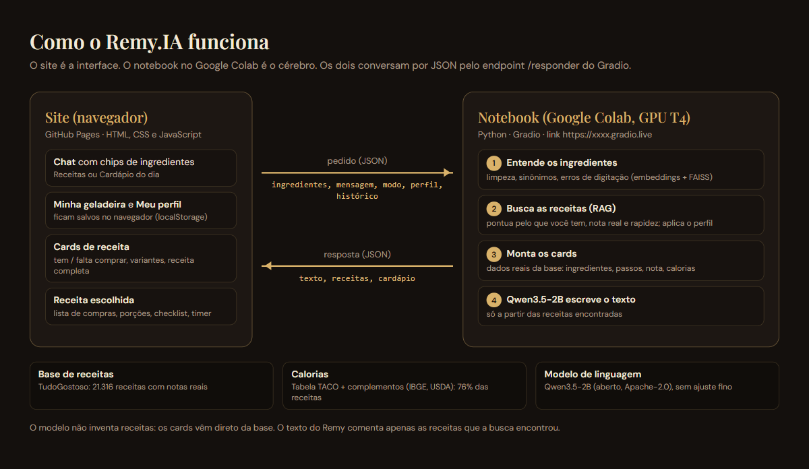
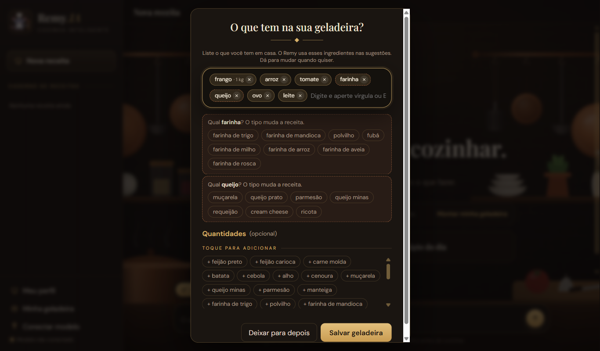
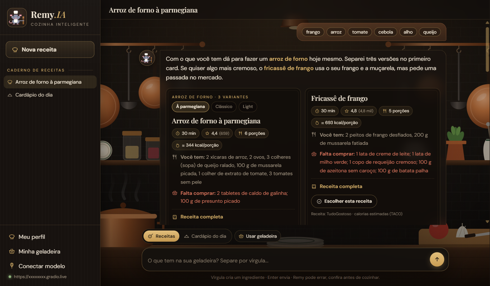
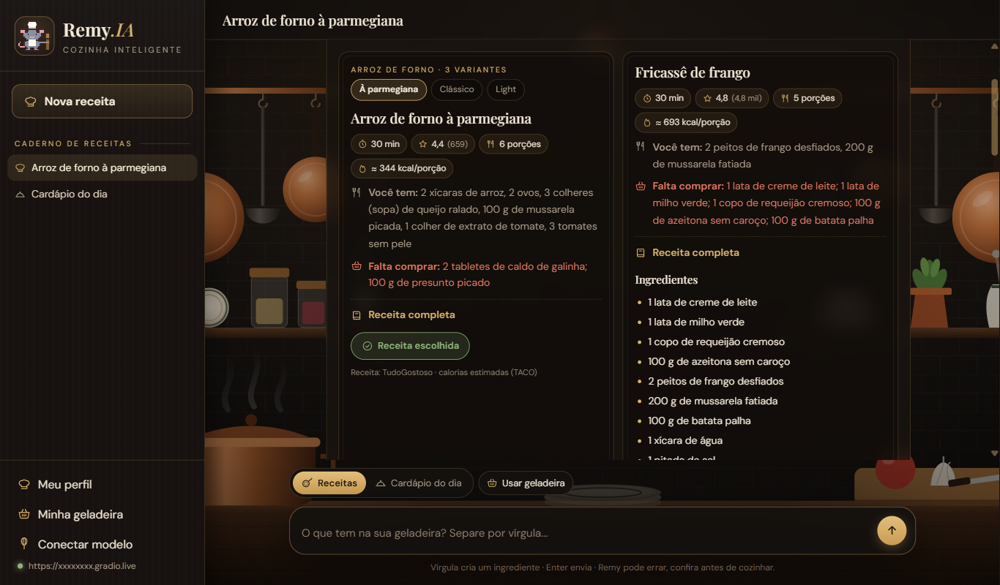
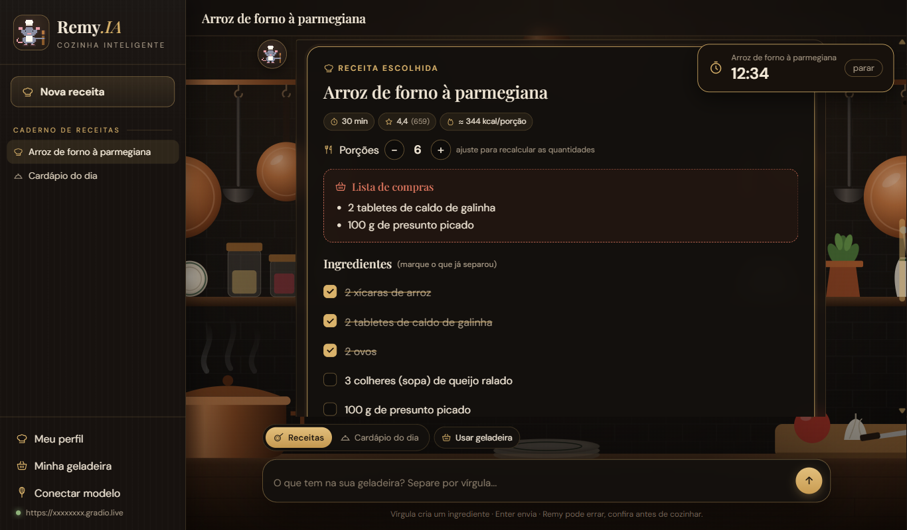
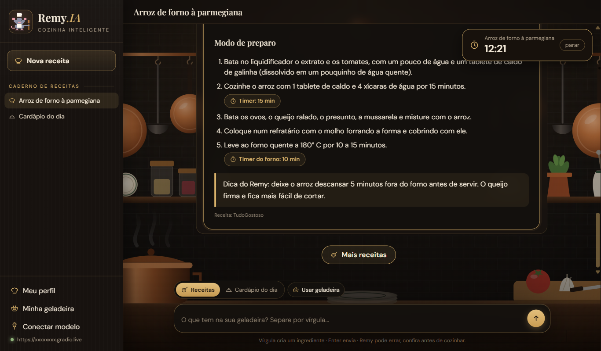
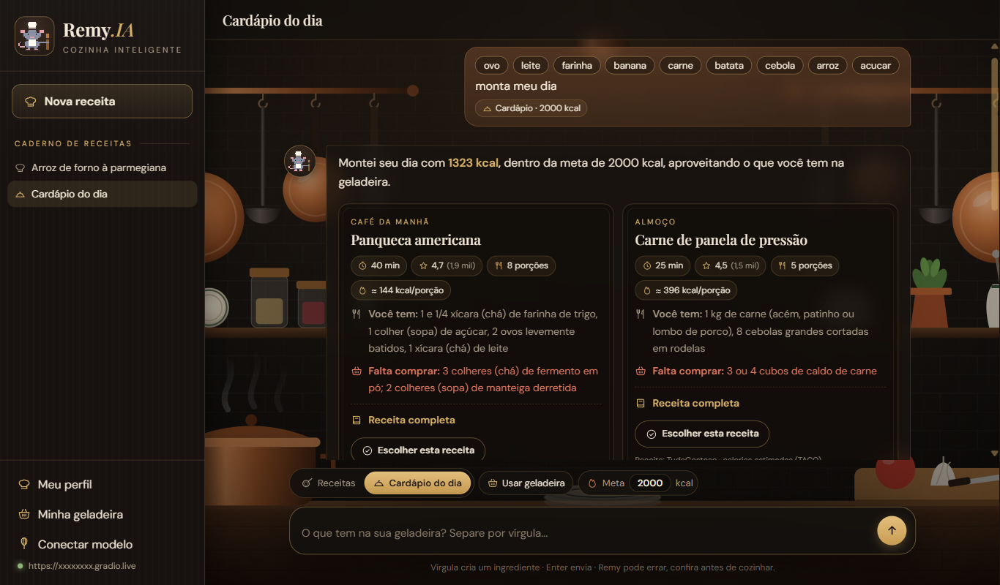
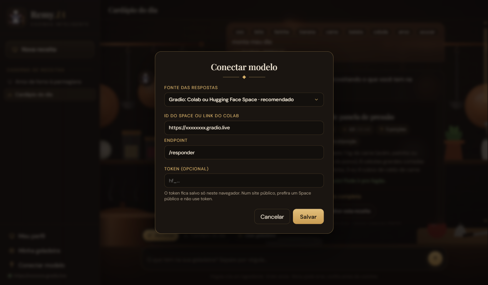
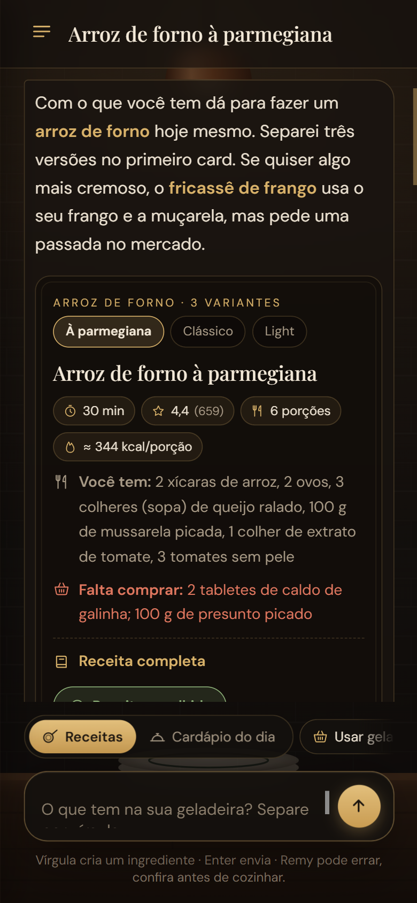
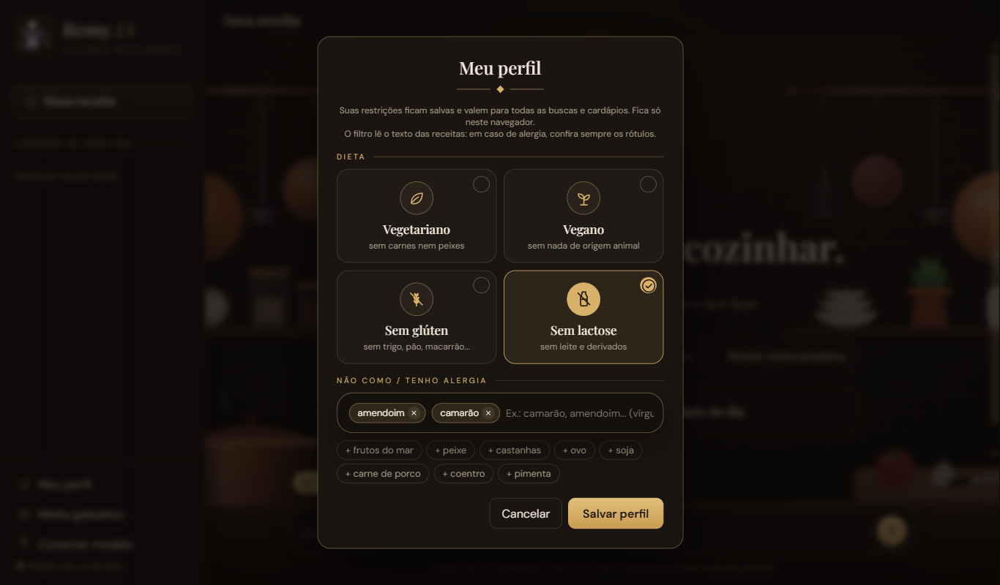

# Remy.IA: documentação do site e da integração com a IA

**Disciplina:** Redes Neurais Artificiais e Machine Learning · Uniso · 6º semestre
**Professor:** Jaime Ranulfo Leite Filho
**Integrantes:** Beatriz, Davi, Kayke e Guilherme
**Site:** https://davileal0702.github.io/Remy.IA/

---

## 1. Visão geral

O Remy.IA é um assistente de culinária em português. O usuário informa os ingredientes que tem em casa e o Remy sugere **receitas brasileiras reais**, mostra o que falta comprar, apresenta a receita completa e monta um **cardápio do dia** dentro de uma meta de calorias.

O sistema tem duas partes:

- **O site**, que é a interface usada pela pessoa. Ele fica publicado no GitHub Pages e roda inteiro no navegador.
- **O notebook no Google Colab**, que é o "cérebro". Ele guarda a base de receitas, faz a busca, calcula o que falta e usa um modelo de linguagem para escrever a resposta do Remy.

As duas partes conversam pela internet trocando mensagens no formato **JSON**.



*Figura 1. Arquitetura do sistema: o site envia o pedido ao notebook e recebe a resposta pronta para exibir.*

---

## 2. O site

### 2.1 Tecnologia

O site foi feito com **HTML, CSS e JavaScript puro**, sem frameworks e sem etapa de compilação. Por isso ele pode ser publicado de graça no **GitHub Pages** e abre em qualquer navegador, no computador ou no celular.

| Arquivo | Papel |
|---|---|
| `index.html` | Estrutura da página (barra lateral, chat, janelas) |
| `style.css` | Visual: tema de cozinha escura com detalhes dourados, adaptado para celular |
| `app.js` | Funcionamento da interface: chat, geladeira, cards, receita escolhida, timer e histórico |
| `api.js` | Comunicação com a IA (envio do pedido e leitura da resposta) |
| `remy.js` | Mascote do Remy em pixel art |
| `assets/cozinha.svg` | Ilustração do fundo |

O histórico de conversas e a geladeira ficam salvos no **próprio navegador** de quem usa (`localStorage`). O site não tem cadastro nem banco de dados: nada disso é enviado para um servidor, a não ser os dados necessários para cada pedido à IA.

> As telas abaixo mostram conversas de exemplo montadas com **receitas reais da base do TudoGostoso**. O texto do Remy nesses exemplos foi escrito para ilustrar o formato da resposta.

### 2.2 Tela inicial


*Figura 2. Tela inicial do Remy.IA.*

A tela segue o padrão de assistentes de conversa conhecidos, como ChatGPT e Claude:

- **Barra lateral (esquerda):** botão *Nova receita*, o **Caderno de receitas** (histórico de conversas) e, embaixo, os botões *Meu perfil* (uma melhoria futura, explicada na seção 6), *Minha geladeira* e *Conectar modelo*, com o status da conexão com a IA (ponto verde quando há um modelo conectado).
- **Centro:** o mascote, a frase "Qualquer um pode cozinhar." e atalhos. Quando a geladeira já está preenchida, os atalhos usam esses ingredientes, por exemplo *O que dá para fazer?* e *Cardápio do dia*.
- **Embaixo:** a caixa de mensagem. Cada vírgula transforma o texto em um **chip** de ingrediente. Acima dela ficam o seletor **Receitas / Cardápio do dia** e o botão **Usar geladeira**, que coloca todos os itens da geladeira na mensagem.

### 2.3 Minha geladeira



*Figura 3. Janela "Minha geladeira".*

É a lista do que a pessoa tem em casa. Ela abre sozinha na primeira visita (dá para pular) e pode ser editada a qualquer momento.

- Os ingredientes são digitados ou escolhidos em **Toque para adicionar**. Com a IA conectada, essa lista mostra todos os ingredientes da base, com busca.
- Alguns ingredientes têm **tipos que mudam a receita**: farinha, fermento, queijo, feijão, chocolate, milho e pimenta. Para eles, o site pergunta qual é (na figura, *Qual farinha?* e *Qual queijo?*).
- A **quantidade** é opcional. Quando informada, o Remy avisa se a receita pede mais do que a pessoa tem.

### 2.4 Resposta com receitas



*Figura 4. Pedido com seis ingredientes e a resposta do Remy.*

A mensagem do usuário aparece à direita, com os ingredientes em chips. A resposta do Remy tem duas partes:

1. **Um texto curto**, escrito pelo modelo de linguagem, que comenta as receitas encontradas.
2. **Cards de receita**, montados com os dados reais da base. Cada card mostra:
   - tempo, nota e número de avaliações dos usuários do TudoGostoso, porções e calorias estimadas por porção;
   - **Você tem:** os ingredientes da receita que a pessoa já tem;
   - **Falta comprar:** o que falta (ou "Tem tudo! Pode ir pro fogão.");
   - **Receita completa** e o botão **Escolher esta receita**.

Receitas parecidas viram **um card só com variantes**. Na figura, o card *Arroz de forno* traz três versões (*À parmegiana*, *Clássico* e *Light*), e um clique troca a versão exibida.

### 2.5 Receita completa



*Figura 5. Card com a receita completa aberta.*

Ao abrir **Receita completa**, o card mostra a lista de ingredientes (separada por partes quando a receita tem, como *Massa* e *Cobertura*) e o modo de preparo, exatamente como estão na base.

### 2.6 Receita escolhida



*Figura 6. Tela da receita escolhida.*

Ao clicar em **Escolher esta receita**, o Remy abre um painel para cozinhar:

- **Porções:** os botões − e + recalculam todas as quantidades (por exemplo, de 6 para 3 porções, "2 xícaras" vira "1 xícara").
- **Lista de compras:** o que falta comprar.
- **Ingredientes para marcar:** um checklist do que já foi separado.
- O nome da receita passa a ser o título da conversa no **Caderno de receitas**.



*Figura 7. Modo de preparo com timers e a dica do Remy.*

- Os passos que têm tempo ("por 15 minutos", "leve ao forno por 10 minutos") ganham um botão de **timer**. O cronômetro aparece no canto da tela e toca um aviso no fim.
- No fim, uma **dica do Remy**, escrita pelo modelo de linguagem.
- O botão **Mais receitas** traz as próximas opções, sem repetir as já mostradas.

### 2.7 Cardápio do dia



*Figura 8. Cardápio do dia.*

No modo **Cardápio do dia**, a pessoa informa uma meta de calorias e o Remy monta o dia com **café da manhã, almoço, acompanhamento, jantar e sobremesa**, aproveitando os ingredientes disponíveis. Cada refeição aparece como um card com o rótulo da refeição, e o texto informa o total de calorias em relação à meta.

### 2.8 Conectar modelo



*Figura 9. Janela "Conectar modelo".*

É onde o site é ligado à IA. A opção recomendada é **Gradio**: basta colar o link gerado pelo notebook no Colab (`https://....gradio.live`) ou o ID de um Space do Hugging Face, com o endpoint `/responder`. A opção alternativa, **API compatível com OpenAI**, conversa direto com um modelo de linguagem, sem a busca nas receitas.

### 2.9 No celular



*Figura 10. O mesmo site no celular.*

O layout se adapta a telas pequenas: a barra lateral vira um menu (botão ☰), os cards ficam em uma coluna e a barra de opções pode ser rolada para o lado.

---

## 3. Integração do site com a IA

### 3.1 Caminho de uma mensagem

1. A pessoa digita os ingredientes (ou usa a geladeira) e envia.
2. O site monta um **pedido em JSON** e o envia para o endpoint `/responder` do Gradio, usando a biblioteca oficial `@gradio/client`.
3. No notebook, o Remy:
   1. **entende os ingredientes:** limpa o texto, junta sinônimos, corrige erros de digitação e encontra o ingrediente mais parecido usando **embeddings** (`paraphrase-multilingual-MiniLM-L12-v2`) e **FAISS**;
   2. **busca as receitas (RAG):** pontua cada receita da base pelo quanto ela usa do que a pessoa tem, pela nota real dos usuários e pela rapidez;
   3. **monta os cards** com os dados reais da receita: ingredientes, passos, nota, porções e calorias;
   4. **gera o texto** com o modelo de linguagem **Qwen3.5-2B**, que recebe só as receitas encontradas.
4. O notebook devolve uma **resposta em JSON**.
5. O site mostra o texto e os cards, e guarda a conversa no histórico do navegador.

Enquanto espera, o site mostra o mascote mexendo a panela com a frase "Remy está cozinhando". Se a IA não estiver conectada, o site avisa "Modelo não conectado".

### 3.2 O pedido (site → IA)

```json
{
  "mensagem": "texto livre digitado (pode ser vazio)",
  "ingredientes": ["frango", "arroz", "tomate"],
  "quantidades": { "frango": { "qtd": 1, "unidade": "kg" } },
  "modo": "receitas",
  "meta_calorias": 2000,
  "perfil": { "dietas": ["sem lactose"], "evitar": ["amendoim"] },
  "historico": [{ "role": "user", "content": "..." }, { "role": "assistant", "content": "..." }]
}
```

| Campo | Significado |
|---|---|
| `mensagem` | O que a pessoa escreveu além dos ingredientes (por exemplo, "algo rápido"). |
| `ingredientes` | Os chips da mensagem. |
| `quantidades` | Quantidades da geladeira, quando informadas. |
| `modo` | `"receitas"` ou `"cardapio"`. |
| `meta_calorias` | Meta do dia, usada no cardápio. |
| `perfil` | Dietas e alimentos a evitar. O site já envia este campo, mas a IA ainda não o usa (melhoria futura, seção 6). |
| `historico` | As últimas mensagens, para o Remy entender a continuação da conversa. |

Há também dois pedidos especiais: `{"acao": "ingredientes"}`, que devolve a lista de todos os ingredientes da base (usada em *Toque para adicionar*), e `{"acao": "dica", "receita": {...}}`, que devolve a dica do Remy para a receita escolhida.

### 3.3 A resposta (IA → site)

```json
{
  "texto": "Com o que você tem dá para fazer um **arroz de forno** hoje mesmo...",
  "receitas": [
    {
      "nome": "Arroz de forno à parmegiana", "minutos": 30, "porcoes": 6,
      "nota": 4.4, "avaliacoes": 659, "calorias": 344, "calorias_aprox": true,
      "tem": ["2 xícaras de arroz", "2 ovos"], "falta": ["100 g de presunto picado"], "pouco": [],
      "ingredientes": [{ "secao": "", "itens": ["2 xícaras de arroz", "..."] }],
      "passos": ["Cozinhe o arroz com 1 tablete de caldo e 4 xícaras de água por 15 minutos.", "..."],
      "fonte": "TudoGostoso"
    },
    { "grupo": "Arroz de forno", "variantes": [{ "rotulo": "Light", "nome": "...", "...": "mesmos campos" }] }
  ],
  "cardapio": { "meta_calorias": 2000, "total_calorias": 1323, "itens": [{ "refeicao": "Almoço", "nome": "...", "calorias": 396 }] }
}
```

- `texto` vira a mensagem do Remy. O site aceita um markdown simples (negrito, itálico e listas).
- Cada item de `receitas` vira um card. Um item com `variantes` vira um card com botões de versão.
- `cardapio` organiza os cards por refeição.
- Todos os campos são opcionais. Se a IA responder só com texto, o site mostra a mensagem sem cards.

### 3.4 Divisão de responsabilidades

| O site faz | A IA (notebook) faz |
|---|---|
| Coletar ingredientes e a geladeira | Entender e normalizar os ingredientes |
| Exibir texto e cards | Buscar e ordenar as receitas na base |
| Recalcular porções, timer e checklist | Calcular o que falta e as calorias |
| Guardar o histórico no navegador | Escrever o texto e a dica com o Qwen3.5-2B |

Essa divisão evita que o modelo **invente receitas**: tudo o que aparece nos cards (ingredientes, passos, notas, calorias) vem direto da base. O modelo de linguagem só escreve o texto de conversa, a partir das receitas que a busca encontrou.

### 3.5 Onde a IA roda

- **Durante os testes e a apresentação:** no **Google Colab** com GPU T4. Ao final do notebook, o Gradio gera um link público `https://....gradio.live`, que é colado no site em *Conectar modelo*. O link funciona enquanto o Colab estiver aberto.
- **Para um uso permanente:** o mesmo código pode ser publicado num **Space do Hugging Face** (a pasta `space/` do repositório tem o modelo do servidor).

---

## 4. Dados

| Dado | Origem | Uso |
|---|---|---|
| **Receitas** | TudoGostoso, coleta autorizada para o trabalho: **21.316 receitas** com notas e número de avaliações reais | Busca e cards |
| **Calorias** | **Tabela TACO** (NEPA/Unicamp, 4ª edição) e complementos (IBGE, USDA e rótulos) | Calorias estimadas por porção em **76%** das receitas |
| **Modelo de linguagem** | **Qwen3.5-2B** (Alibaba, licença Apache-2.0), sem ajuste fino | Texto do Remy e dicas |

O caminho dos dados está descrito em `dados/LEIA-ME.md`. A base de receitas não fica no GitHub: ela é grande e o uso foi autorizado apenas para este trabalho. Por respeito à LGPD, a coluna com o nome de quem publicou cada receita foi retirada.

---

## 5. Limitações

- **Calorias são estimativas.** Elas dependem das medidas caseiras (xícara cheia ou rasa) e das porções informadas pelos autores. O site mostra o sinal "≈" e a margem de erro não foi medida.
- **A IA precisa estar ligada.** Com o Colab desligado, o site abre normalmente, mas não responde. O link do Colab muda a cada execução.
- **Dados locais.** Histórico e geladeira ficam no navegador: não passam de um aparelho para outro.

---

## 6. Melhorias futuras

### 6.1 Meu perfil (restrições alimentares)



*Figura 11. Janela "Meu perfil", já presente no site.*

A janela **Meu perfil** já existe no site, mas **ainda não faz parte da versão atual do projeto**. A pessoa consegue marcar uma dieta (vegetariano, vegano, sem glúten ou sem lactose) e listar alimentos que não come ou aos quais tem alergia. As escolhas ficam salvas no navegador e o site já as envia no pedido (campo `perfil`), mas **a IA ainda não aplica esses filtros nas buscas**: as receitas sugeridas podem conter itens marcados no perfil.

Para funcionar, o próximo passo é a busca no notebook descartar as receitas que não combinam com o perfil, olhando o nome, os ingredientes e o modo de preparo. Mesmo assim, como o filtro dependeria do que o autor da receita escreveu, em caso de alergia continuaria sendo necessário conferir os rótulos dos produtos.

### 6.2 Filtros de busca: "Tipo" e "Pode faltar"


*Figura 12. Os seletores "Tipo" e "Pode faltar", como apareciam numa versão anterior do site.*

Uma versão anterior do site tinha dois seletores ao lado de **Receitas / Cardápio do dia**, que foram **retirados da versão atual** para simplificar a interface:

- **Tipo:** limitava a busca a um tipo de receita: *Qualquer*, *Café da manhã* (bolos, pães, lanches, bebidas), *Prato principal* (carnes, aves, massas, peixes) ou *Sobremesa* (doces, pudins, mousses).
- **Pode faltar:** definia quantos ingredientes a receita podia pedir além do que a pessoa tem: *Nada* (só receitas com o que ela tem), *Até 2*, *Até 5* ou *Tanto faz*.

O notebook ainda entende esses dois campos do pedido (`tipo` e `max_faltantes`). Sem eles, a busca considera todos os tipos de receita e aceita até 2 ingredientes faltando, e a pessoa ainda pode pedir pelo texto, por exemplo *"quero uma sobremesa"* ou *"só com o que eu tenho"*. Voltar com os seletores no futuro exige apenas mudanças no site.

